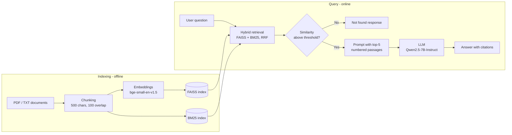
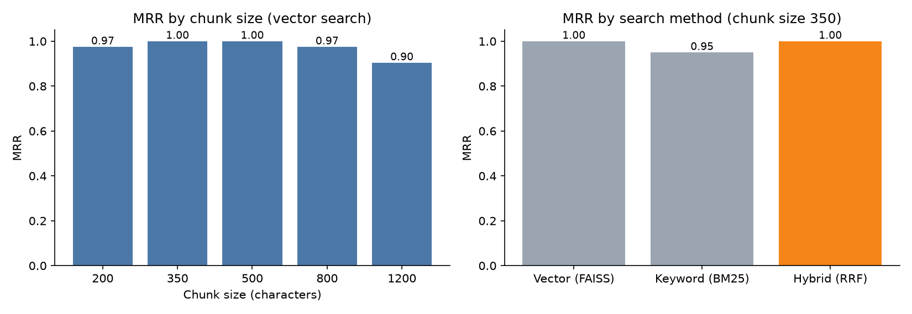

# Wind & Solar Resource Assessment RAG Assistant

A retrieval-augmented generation (RAG) system that answers technical questions on wind and solar resource assessment from a document corpus, with source citations and an out-of-scope guardrail.

**Live demo:** [Hugging Face Space](https://huggingface.co/spaces/YOUR_USERNAME/wind-solar-rag-assistant) &nbsp;|&nbsp; **Notebook:** [`notebooks/rag_pipeline.ipynb`](notebooks/rag_pipeline.ipynb)


## Features

- **Semantic retrieval** with Hugging Face embeddings (`BAAI/bge-small-en-v1.5`) and a FAISS inner-product index
- **Hybrid search** combining dense vectors and BM25 keyword search via Reciprocal Rank Fusion
- **Grounded generation** with an open-source LLM (`Qwen2.5-7B-Instruct`) through the Hugging Face Inference API, with automatic fallback to a local model
- **Source citations** for every answer (file and page)
- **Out-of-scope guardrail** that refuses low-confidence queries before calling the LLM
- **Retrieval evaluation** (Hit@5, MRR) across chunk sizes and search strategies
- Supports **PDF and text** documents

## Architecture



## Results

Retrieval evaluated on 20 labelled questions ([`eval/questions.json`](eval/questions.json)). A hit means the source document containing the answer appears in the top 5 retrieved chunks.

| Search method | Hit@5 | MRR |
|---|---:|---:|
| Vector (FAISS) | 100% | 1.00 |
| Keyword (BM25) | 100% | 0.95 |
| **Hybrid (RRF)** | **100%** | **1.00** |



Full results, including the chunk-size comparison, are in [`eval/results.md`](eval/results.md).

## Tech Stack

| Component | Tool |
|---|---|
| Embedding model | `BAAI/bge-small-en-v1.5` (Hugging Face, sentence-transformers) |
| Vector store | FAISS (`IndexFlatIP`, cosine similarity) |
| Keyword search | BM25 (`rank-bm25`) |
| LLM | `Qwen/Qwen2.5-7B-Instruct` via Hugging Face Inference API |
| Local fallback LLM | `Qwen/Qwen2.5-0.5B-Instruct` (transformers) |
| PDF parsing | pypdf |
| UI and deployment | Gradio, Hugging Face Spaces |

## Project Structure

```
wind-solar-rag-assistant/
├── app.py                 # Gradio web app (Hugging Face Spaces entry point)
├── rag.py                 # Core pipeline: loading, chunking, retrieval, generation
├── ingest.py              # Builds the FAISS index from data/
├── evaluate.py            # Retrieval evaluation and charts
├── data/                  # Source documents (.txt, .pdf)
├── eval/
│   ├── questions.json     # Labelled evaluation set
│   └── results.md         # Evaluation output
├── notebooks/
│   └── rag_pipeline.ipynb # End-to-end pipeline walkthrough
├── assets/                # Images used in this README
├── requirements.txt
└── .env.example
```

## Getting Started

**Prerequisites:** Python 3.10+ and a free [Hugging Face access token](https://huggingface.co/settings/tokens) (Read type).

```bash
git clone https://github.com/YOUR_USERNAME/wind-solar-rag-assistant.git
cd wind-solar-rag-assistant

python -m venv venv
source venv/bin/activate          # Windows: venv\Scripts\activate
pip install -r requirements.txt

export HF_TOKEN=hf_xxx            # Windows: set HF_TOKEN=hf_xxx

python ingest.py                  # build the index
python app.py                     # launch the app at http://127.0.0.1:7860
python evaluate.py                # optional: reproduce the evaluation
```

**Prefer Jupyter?** Run [`notebooks/rag_pipeline.ipynb`](notebooks/rag_pipeline.ipynb) top to bottom.

Without `HF_TOKEN`, the app runs a small local model instead (slower, lower quality).

To use your own documents, add PDF or text files to `data/` and run `python ingest.py` again.

## Example

**Question:** What is the P50 net energy of the Thoothukudi Ridge project?

**Answer:** The P50 net energy is 312 GWh/yr, corresponding to a net capacity factor of about 25.7% [1].

**Sources:** [1] `09_thoothukudi_ridge_site_report.txt`

*(Thoothukudi Ridge is a fictional project created to test that answers come from the documents rather than the model's training data.)*

## Design Decisions

- **Chunk size 500 / overlap 100** was selected from the chunk-size evaluation: smaller chunks lost context, larger chunks diluted relevance.
- **Hybrid retrieval** recovers exact identifiers and standard names (e.g. `TR-01`, `IEC 61400-1`) that dense embeddings tend to miss.
- **The similarity threshold** returns a fixed "not found" response for out-of-scope questions, reducing hallucination and avoiding unnecessary LLM calls.
- **Low temperature (0.1)** and a strict system prompt keep answers grounded in the retrieved passages.

## Limitations and Future Work

- Retrieval is evaluated at document level; answer correctness is not yet scored (planned: RAGAS faithfulness and answer relevance).
- Add a cross-encoder re-ranker (`BAAI/bge-reranker-base`).
- Extend the corpus with public NREL, IEA Wind and ECMWF publications.
- Table and figure extraction from PDFs is not supported.

## License

This project is licensed under the MIT License. See [LICENSE](LICENSE).
